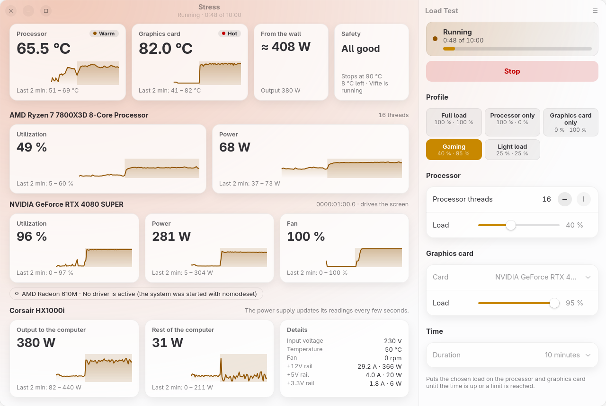
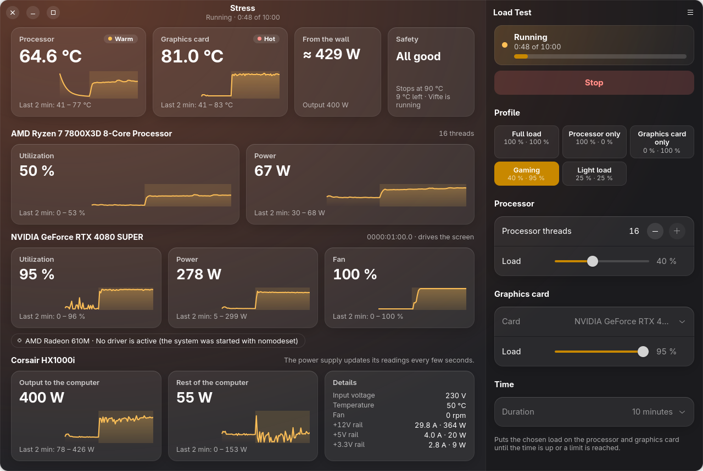
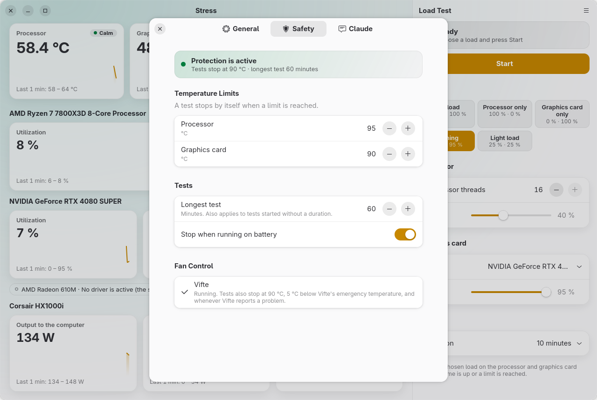
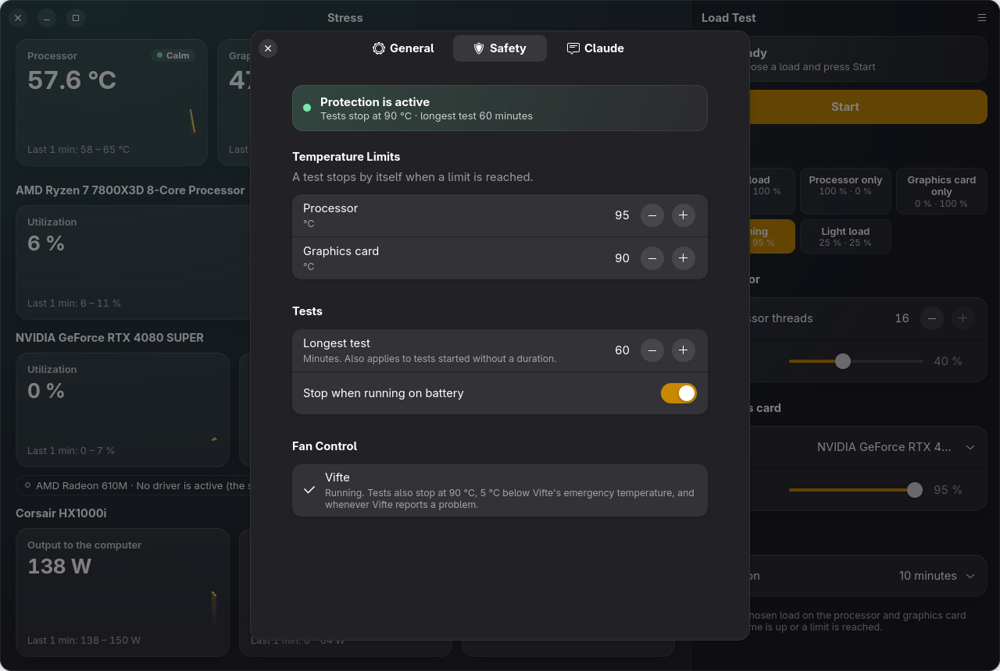
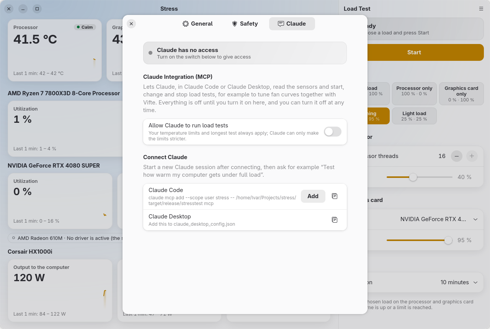
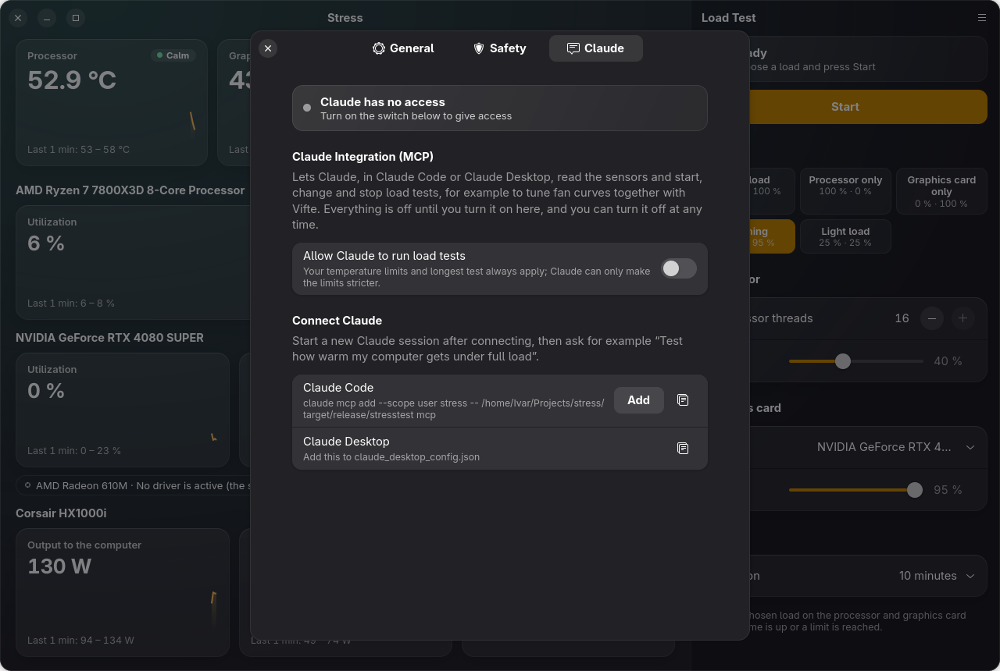

# Stress – CPU and GPU stress test for Linux

[](https://github.com/Vindihaaret/stress/actions/workflows/ci.yml)

<p align="center">
  <picture>
    <source media="(prefers-color-scheme: dark)" srcset="docs/screenshots/test-dark.png">
    
  </picture>
</p>

Stress puts a controlled load on your processor and graphics card and shows what happens: temperatures,
utilization, fan speed and power use, with graphs of the last 30 minutes. Use it to check that a new
computer stays cool, to compare cooling changes, or to tune fan curves – by hand, or together with Claude
and [Vifte](https://github.com/Vindihaaret/vifte).

* **Native GTK 4 / libadwaita interface** that fits into GNOME, follows the light/dark theme and also runs
  on KDE Plasma.
* **Processor load** on as many threads as you choose, at a chosen share of the time (1–100 %). Dense
  vector arithmetic, so the load produces real heat – no stress-ng needed.
* **Graphics card load** on the card you pick (computers with several cards included), at a chosen
  utilization that the load holds by measuring its own time on the card. Works with NVIDIA, AMD and Intel
  through EGL; each card is loaded in its own process.
* **Profiles** (full load, processor only, graphics card only, gaming, light load), durations from one
  minute to "until stopped", and levels that can be changed while a test runs.
* **Live readings and 30-minute graphs**: processor temperature, utilization and power; per graphics card
  temperature, utilization, power and fan; test periods are tinted in the graphs. An overview at the top
  shows the temperatures, power use and how far a test is from its limit, and the window takes on a soft
  tint that follows the temperature (it can be turned off in the preferences).
* **Power supply readings** where the power supply reports them (Corsair HXi/RMi/AXi): output to the
  computer, an estimate of the draw from the wall, the rest of the computer (motherboard, memory, disks,
  fans) and every rail's voltage, current and power.
* **Safety limits** enforced by Stress: temperature limits, a longest test, stop on battery power – and,
  when Vifte controls the fans, a stop 5 °C below Vifte's emergency temperature.
* **Status icon** that shows the temperature while a test runs; optionally keep running in it when the
  window is closed.
* **Claude integration (MCP)**, off by default: let Claude run and follow tests for you, for example to
  tune fan curves in Vifte.
* **Updates from GitHub** inside the app, and a command line for scripts.
* English and Norwegian user interface.

*From Norway with Love ❤️*

Made by **Jan Ivar Sørensen** using [Claude Code](https://claude.com/claude-code), Anthropic's AI coding
assistant – from the load generators and sensor readings to the interface, the safety rules and the Claude
integration.

## Screenshots

| Light | Dark |
|---|---|
|  |  |
|  |  |
|  |  |

## Requirements

* Linux with GTK ≥ 4.14 and libadwaita ≥ 1.5 (e.g. Fedora 40+, Ubuntu 24.04+, openSUSE Tumbleweed, Arch)
* For graphics card load: a graphics driver with EGL (Mesa for AMD and Intel, or the NVIDIA driver)
* Only to build from source: Rust ≥ 1.88 (the install script installs it if your distribution's version
  is recent enough; otherwise use [rustup](https://rustup.rs))
* Optional, GNOME only: the
  [AppIndicator and KStatusNotifierItem Support](https://extensions.gnome.org/extension/615/appindicator-support/)
  extension for the status icon

## Installation

On a normal 64-bit PC (x86_64), download the ready-made program from the
[latest release](https://github.com/Vindihaaret/stress/releases/latest) – one small package:

```bash
curl -LO https://github.com/Vindihaaret/stress/releases/latest/download/stresstest-x86_64-linux.tar.gz
tar -xzf stresstest-x86_64-linux.tar.gz
./stresstest/install.sh
```

The script installs Stress for your user under `~/.local` with a menu entry and icons – no root needed.
Only if GTK 4 or libadwaita is missing does it install them with your package manager (zypper, dnf, apt
or pacman) and ask for your sudo password. Afterwards you can delete the downloaded file and the
`stresstest` folder.

Start **Stress** from the application menu, or run `stresstest`.

The program is built from this repository's code by GitHub Actions
([workflow](.github/workflows/release.yml)), on Ubuntu 24.04 so it runs there and on newer
distributions. To check that a download was built from this repository:

```bash
gh attestation verify stresstest-x86_64-linux.tar.gz --repo Vindihaaret/stress
```

### Build from source

The full source code is in this repository. For other processors, or if you prefer to build it yourself:

```bash
git clone https://github.com/Vindihaaret/stress.git
cd stress
./install.sh
```

The script installs missing build tools with your package manager (Rust, a C compiler and the GTK 4 and
libadwaita development files; asks for your sudo password only then), builds Stress and installs it the
same way. Afterwards it offers to delete the build files in `target/`.

### Update

Stress looks for a new release on GitHub once a month (turn it off under **Preferences → General →
Updates**), and you can check yourself with **Menu → Check for Updates …**. When there is a new version
you see what is new and can choose **Update Now**: Stress downloads the ready-made program, checks its
checksum and version, and installs it into `~/.local` – no password needed. On other processors it
downloads the source code and builds it instead, and deletes the build files afterwards. Restart Stress
afterwards.

The check uses GitHub's public API; nothing about you is sent. If you run Stress from a source folder
(`cargo run`), update with `git pull` instead.

### Uninstall

Click **Uninstall** at the bottom of **Preferences → General**, or run:

```bash
./uninstall.sh           # removes the program, keeps settings
./uninstall.sh --purge   # also removes ~/.config/stresstest
```

Both also remove the system helper (see [Processor power](#processor-power)) if Stress installed it, and
the app's own uninstaller removes the Claude Code registration.

## Load tests

| Setting | What it does |
|---|---|
| Profile | Full load (100/100), Processor only, Graphics card only, Gaming (40/95), Light load (25/25), or Custom |
| Processor threads | How many of the processor's threads are loaded |
| Load (processor) | Share of the time each loaded thread works, in 100 ms periods |
| Card | Which graphics card to load; cards that cannot be used are labelled with the reason |
| Load (graphics card) | Share of the time the card works on the load |
| Duration | 1–60 minutes, or until stopped (never longer than the longest test in the preferences) |

The graphics card load is utilization – the share of the time the card is busy – as NVIDIA's and AMD's
tools report it. At low utilization the driver lowers the clocks, so a light load also heats little, just
as a light program would; for real heat use about 40 % or more. Right after a test starts, the driver
briefly runs the card at full clock before it settles, which shows as a short peak in the graphs.

## Safety

These rules are enforced by Stress itself, for tests you start and for tests Claude starts:

* A test stops when the processor or a loaded graphics card reaches its **temperature limit** (95 °C and
  90 °C by default, under **Preferences → Safety**).
* No test runs longer than the **longest test** (60 minutes by default).
* A test stops when a laptop switches to **battery power** (batteries in mice and keyboards are ignored).
* A test stops when the graphics card load ends unexpectedly, and when Stress is closed.
* When **[Vifte](https://github.com/Vindihaaret/vifte)** controls the fans, tests also stop 5 °C below
  Vifte's emergency temperature, and whenever Vifte switches to emergency mode, loses a fan curve's
  sensor or is paused. Stress reads this from Vifte's service; nothing needs to be set up.

The checks run after every sensor reading on a background thread, so a busy window cannot delay them.

## Sensors

| Reading | Source |
|---|---|
| Processor temperature | `k10temp`, `zenpower` (AMD) or `coretemp` (Intel) |
| Processor utilization | `/proc/stat` |
| Processor power | RAPL energy counters (`/sys/class/powercap`), see below |
| NVIDIA graphics card | NVML from the NVIDIA driver: temperature, utilization, power, fan |
| AMD graphics card | `amdgpu`: temperature, `gpu_busy_percent`, power |
| Intel graphics card | `i915`/`xe`: temperature and power where the driver reports them |
| Power supply | `corsair-psu` driver (Corsair HXi, RMi and AXi over USB) |

Readings are taken once a second and kept for 30 minutes.

### Processor power

Some distributions let only root read the processor's energy counters. Stress then shows **Allow …**
under the processor: it installs a small udev rule (`/etc/udev/rules.d/60-stresstest-rapl.rules`) with the
administrator password that makes them readable. Some systems keep these counters private because, in
rare cases, they can be used to work out secrets such as encryption keys; the dialog explains this before
anything is changed. The rule can be removed under **Preferences → General → System Helpers**, and is
removed when Stress is uninstalled.

### Power supply

Without a power supply that reports its readings, the power supply section is simply not shown. Corsair
power supplies are named from their USB descriptor (for example "Corsair HX1000i"); if no name can be
read, the section is called "PSU". The power supply measures what it delivers to the computer, not what
it draws from the wall: **From the wall** is calculated from the efficiency class (80 PLUS Titanium for
AXi, Platinum for HXi, Gold for RMi) and marked with ≈. Power supplies update their readings every few
seconds, so they lag behind the other sensors.

## Status icon

Stress shows a status icon (StatusNotifierItem) with Show, Start/Stop test and Quit. While a test runs it
shows the hottest loaded temperature, and the tooltip lists the readings. KDE Plasma shows it out of the
box; GNOME needs the
[AppIndicator extension](https://extensions.gnome.org/extension/615/appindicator-support/).

With **Preferences → General → Window → Keep in the status icon when the window is closed**, closing the
window leaves Stress running in the status icon and a running test carries on; messages then come as
desktop notifications.

## Claude integration (MCP)

Stress includes an [MCP](https://modelcontextprotocol.io) server, so Claude (in Claude Code or Claude
Desktop) can read the sensors and start, change and stop load tests. Together with Vifte's own MCP
server, Claude can tune your fan curves: run a steady load, wait until the temperatures level off, adjust
the curves in Vifte, and run the same load again to compare.

**It is off until you turn it on**, in Stress → Preferences → Claude (**Allow Claude to run load tests**),
and can be turned off again at any time. Your temperature limits and longest test always apply; Claude
can only make the limits stricter. Every test Claude starts, changes or stops shows a notice, the panel
shows the levels Claude chose, and the status says the test was started by Claude.

### Connecting

Click **Add** under Preferences → Claude, or run:

```bash
claude mcp add --scope user stress -- stresstest mcp
```

For Claude Desktop, add this to `claude_desktop_config.json` (use the full path, e.g.
`/home/you/.local/bin/stresstest`, if `~/.local/bin` is not on Claude Desktop's PATH):

```json
{ "mcpServers": { "stress": { "command": "stresstest", "args": ["mcp"] } } }
```

Start a new Claude session and ask, for example:

* "Test how warm my computer gets under full load for ten minutes."
* "Run a gaming-like load and tune my case fans in Vifte so the graphics card stays under 75 °C."
* "Compare the processor temperature now with the test we ran half an hour ago."

If Stress is not running, `stresstest mcp` starts it, so you always see what Claude is doing.

Tools: `get_status`, `get_history`, `start_test`, `set_load`, `stop_test`.

## Command line

```bash
stresstest probe                     # processor, graphics cards and sensors
stresstest monitor --seconds 60      # print readings every second
stresstest run --cpu-load 100 --gpu 0000:01:00.0 --gpu-load 80 --seconds 300
```

`stresstest run` takes `--cpu-threads`, `--cpu-load`, `--gpu` (PCI address from `probe`), `--gpu-load`,
`--seconds`, `--cpu-limit` and `--gpu-limit`, and stops at the limits like the app (without Vifte's).

## Troubleshooting

* **A graphics card is listed as "cannot be loaded"** – the reason is shown next to it. "No driver is
  active (the system was started with nomodeset)" means the kernel parameter `nomodeset` keeps the card's
  driver from starting.
* **Processor power is missing** – see [Processor power](#processor-power).
* **No status icon on GNOME** – install and enable the AppIndicator extension.
* **Graphics card utilization goes above the level you set** – other programs and the desktop use the card
  too, and count for more when the driver has lowered the clocks. Stress only sets its own share.

## Files

| Path | Contents |
|---|---|
| `~/.local/bin/stresstest` | The program |
| `~/.config/stresstest/config.json` | Settings and the last test setup |
| `/etc/udev/rules.d/60-stresstest-rapl.rules` | Processor power access (only when you allowed it) |

## Translations

English is the source language. Translations are gettext catalogs in `po/` and are embedded into the
binary at build time; the language follows the desktop locale (`LANGUAGE`, `LC_MESSAGES`, `LANG`) or the
choice in Preferences.

```bash
./po/update-po.sh              # refresh po/stresstest.pot and merge into all .po files
cp po/stresstest.pot po/de.po  # start a new language, then fill in msgstr
```

To try a language from a terminal: `LANGUAGE=nb stresstest`.

## Development

```bash
cargo run                      # run from the source tree
cargo clippy                   # lint
cargo test                     # unit tests
stresstest mcp                 # the MCP server (normally started by Claude)
```

`STRESS_SCREENSHOT=out.png STRESS_PAGE=preferences-safety stresstest` renders the window (optionally
`preferences`, `preferences-claude` or `about`) to a PNG and quits – GNOME on Wayland does not let other
programs capture windows. `STRESS_SCREENSHOT=out.png STRESS_PAGE=tour` idles 30 seconds, starts a test with
the saved setup and writes the picture after `STRESS_SCREENSHOT_DELAY` seconds; the
screenshots in `docs/screenshots` were made this way. Screenshot runs are a separate instance, so they
work next to an open Stress.

To make a release: bump `version` in `Cargo.toml`, commit and push, create a draft release with the
notes (`gh release create vX.Y.Z --draft --title "Stress X.Y.Z" --notes …`), then push the tag `vX.Y.Z`.
The [release workflow](.github/workflows/release.yml) builds the program, attaches it with its checksum
and build attestation, and publishes the release – so the in-app updater only sees it once the download
is there.

## License

Copyright © 2026 Jan Ivar Sørensen

Stress is free software: you can redistribute it and/or modify it under the terms of the
[GNU General Public License](LICENSE) as published by the Free Software Foundation, either version 3 of
the License, or (at your option) any later version.

Stress is distributed in the hope that it will be useful, but WITHOUT ANY WARRANTY; without even the
implied warranty of MERCHANTABILITY or FITNESS FOR A PARTICULAR PURPOSE. See the GNU General Public License
for more details.
